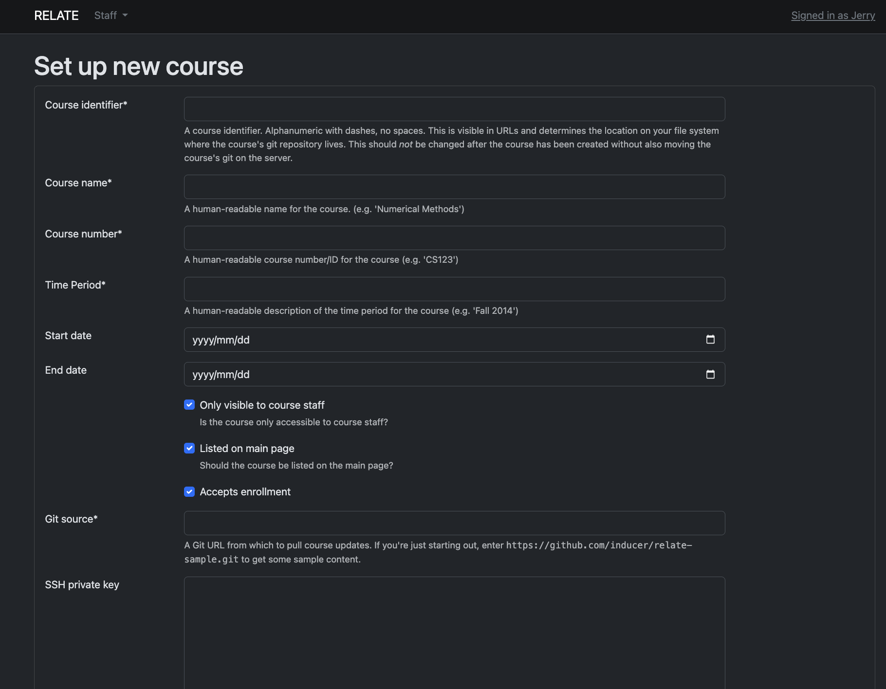

# QUARLATE: a simple workflow for computational course websites 

## Introduction 
The idea is to have a course website that can 
1. Have online lecture notes with code snippet that can be modified and run within browser 
2. Homework and quiz with gradable coding questions(with grading happening on server so that it can't be forged)
3. Exams with coding questions that is of the same format as homework and quizzes but hosted from computer test center(e.g. CBTF at UIUC)

(1) is accomplished by quarto + pyodide. (2) and (3) is done through RELATE. 


## Demo Set Up 
The current demo(updated by Nov 22) includes a single lecture note and a single hw. 

### Quarto Website 
The quarto website was set up by two components:
1. `_quarto.yml` file that specifies which files to include, name of website, packages required etc.
2. qmd files that describe the actual pages
   1. The syntax used was simple:
      1. ```::: {.callout-note title="Proposition"} :::``` for callouts 
      2. \```{pyodide}\```  for runnable code snippet 
      3. ```$$ $$``` for equations 
      4. See `theta_neuron.qmd` for more examples 
3. Start the quarto website by: `quarto preview`

### Relate Demo Setup
**Overview** For the demo since we are essentially using our personal laptop as the server, we need to have RELATE cloned and running with a docker container for running code. In actual production, this part will be delegated to servers owned by the department. However, for development purpose, having a local server ready is always perferred to test code changes before releasing the actual assignments. 

#### Step 1 : Start the server 
RELATE is described by the folder `/relate`. The demo runs the code on the local device, therefore to run the demo we 
need to first register device as a RELATE server. To do so:

1. After writing `course.yml` in relate, run `make_course_repo.sh`, this repo creates a github repo `_course_repo` to host RELATE server.(Running this script after the github repo exists would just add new updates as commits)
2. Configure and initialization of the local server:
   1. Clone relate: `git clone https://github.com/inducer/relate` and cd into the folder
   2. `cp local_settings_example.py local_settings.py`
   3. in `local_settings.py`,  Add "127.0.0.1" and "localhost" to ALLOWED_HOSTS
   4. Build the database: 
    ```uv run python manage.py migrate```
    ```uv run python manage.py createsuperuser```
   5. Use The node package manager(npm) to builds CSS and Javascripts that render the pages with proper styling:
    ``` install && npm run build```
3. RELATE grades PythonCodeQuestion answers by running the student's code inside a Docker container. To setup docker:
   1. Download docker desktop 
   2. Pull the image `docker pull inducer/relate-runcode-python-amd64`
4. Start the server `uv run python manage.py runserver`, the RELATE server will now be hosted at `http://127.0.0.1:8000`
   
#### Step 2 : Set up the course 
For demo purposes, create a superuser and then login in the local RELATE server. Then create a new course by filling the required information. The page should resemble



In particular, fill in the path to the git repo `Git source`. If the git repo is generated by the script `make_course_repo.sh` then it should exists at `Quarlate/_course_repo`


