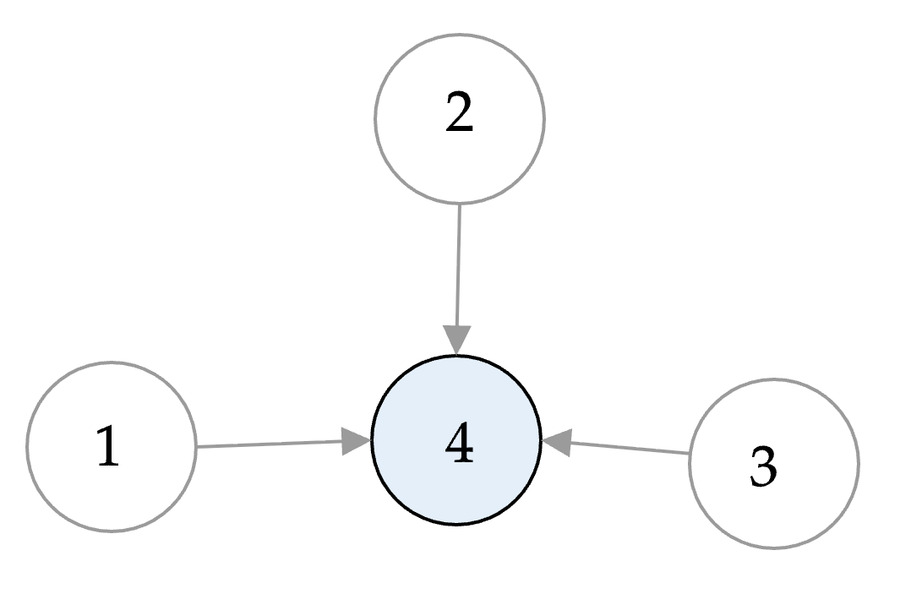

**Acknowledgment**: This note is based on Professor Rainer's notebooks and PPTs. No AI tool is used.


## Quadratic Integrate and Fire Neuron 

### A Free Neuron 
A spiking neural network can just be a graph $G$ where each node is associated with a time-varying nodal function $V_i(t)$. When a neuron fires($V_{i}(t)\to \infty$), it "kicks" postsynaptic neurons(i.e, $j\in N^+(i)$ in graph terms) by changing their potential.

We first consider just a single neuron, with no connection. A **quadratic integrate and fire neuron**(QIF):

$$
\tau \frac{dV}{dt}=V^2+I
$${#eq-free_neuron}

This equation is readily solvable by separation of variable:

::: {.callout-note title="Proposition"}
A free QIF neuron follows:
$$
V(t)=\sqrt{I}\tan\left(\frac{\sqrt{I}t}{\tau}\right)
$$
:::

```{pyodide}
import matplotlib.pyplot as plt
import numpy as np

tau = 1 
I = 1

t=np.linspace(-10, 10, num=100)
plt.plot(t, np.sqrt(I) * np.tan(t*np.sqrt(I)/tau))
plt.show()
```


::: {.callout-tip title="Proof" collapse="true"}
We can symbolically divide $V^2+I$ on both side and then "multiply" by $dt$:
$$
\begin{align}
\tau\int \frac{dV}{V^2+I}  &=\int dt \\
\tau\int \frac{dV/I}{(V/\sqrt{I})^2+1}  &=\int dt \\
\frac{\tau}{\sqrt{I}}\int \frac{d(V/\sqrt{I})}{(V/\sqrt{I})^2+1}  &=\int  dt \\
\end{align}
$$
Where we divided by $I$ in both the numerator and denominator in the second step. Now if we change variable $u\gets V/\sqrt{I}$ we have the standard integral $\int \frac{1}{1+u^2}du=\arctan(u)$ on the L.H.S hence:
$$
\arctan(V/\sqrt{I})=\frac{\sqrt{I}t}{\tau}
$$
Thus:
$$
V(t)=\sqrt{I}\tan\left(\frac{\sqrt{I}t}{\tau}\right)
$$
:::

When a neuron **fires**, $V$ goes to infinity. This makes firing not very well-defined. However a simple coordinate transformation makes the dynamics much nicer:

:::{.callout-note title="Definition: Phase Coordinate"}
Let the phase coordinate be 
$$\phi = 2\arctan \left(\frac{V}{\sqrt{I}}\right)$${#eq-fowardt}
Or equivalently,
$$V = \sqrt{I}\tan \left(\frac{\phi }{2}\right)$${#eq-backwardt}

:::

Hence the free neuron equation @eq-free_neuron becomes:

$$
\tau \frac{d\phi}{dt}=\tau \frac{d\phi }{dV}\frac{dV}{dt}=\frac{2\sqrt{I}}{I+V^2}\left(\tau \frac{dV}{dt}\right)=2\sqrt{I}
$$

::: {.callout-note title="Proposition"}
A free QIF neuron follows:
$$
\frac{d\phi}{dt}=2\sqrt{I}
$$
if we define $\omega:=2\sqrt{I}$ then we have a uniform circular motion:
$$
\frac{d\phi}{dt}=\omega
$$
:::

Note when $V\to \infty$, $\phi \to \pi$. When $\phi=\pi$, we call the neuron **firing**. 

### Inhibitory Network

We assemble a network from QIF neurons using a simple rule: when the presynaptic neuron fires, we send a kick(a change in potential $V$ or phase $\phi$) to the postsynpatic neuron. 

:::{.callout-note title="Definition: Inhibtory QIF network"}
Let $G=(V,E)$ be a graph, for any connection $j\to i$, we call $j$ the presynaptic neuron and $i$ the postsynaptic neuron. When $j$ fires($\phi_j=\pi$), it sends a inhibitory kick 
to neuron $i$ and changes $V_i$ by $\tau J_{ij}$, $J_{ij}\leq 0$. Mathematically this is described by the Dirac delta: 
$$
\frac{dV_i}{dt}=V_i^2 + I + \sum_{k=1}^{\infty}J_{ij}\delta(t-t^k_{j})
$$
where $t_j^k = t_j^1,t_j^2,...$is a sequence reprenting the time stamps when $j$ fires($\forall k\in 1,2,..$, $\phi_j(t_j^k)=\pi$). 

More generally:
$$
\frac{dV_i}{dt}=V_i^2 + I + \sum_{k=1}^{\infty}\sum_{j\in N^-(i)}J_{ij}\delta(t-t^k_{j})
$$

where we adopted the graph theory notation for in-neighbors(presynaptic neurons) $N^-(i)=\text{presynaptic}(i)$
:::

:::{.callout-caution title="Example: Inhibtory QIF network" }


:::{style="text-align: center;"}
{width=50%}
:::
Writing out the dynamics equation in matrix-vector form:
$$
\frac{d\mathbf{V}}{dt} = \mathbf{V}^2 + I\mathbb{I} + \sum_{k=1}^{\infty} \begin{pmatrix} 0 & 0 & 0 & 0 \\ 0 & 0 & 0 & 0 \\ 0 & 0 & 0 & 0 \\ J_{41} & J_{42} & J_{43} & 0 \end{pmatrix} \begin{pmatrix} \delta\left(t - t_1^k\right) & 0 & 0 & 0 \\ 0 & \delta\left(t - t_2^k\right) & 0 & 0 \\ 0 & 0 & \delta\left(t - t_3^k\right) & 0 \\ 0 & 0 & 0 & \delta\left(t - t_4^k\right) \end{pmatrix} \mathbf{V}
$$
where $\mathbb{I}$ is the identiy matrix. 
:::

This equation is techinically solvable numerically, using some predictor-corrector scheme(e.g. RK4). However, it is much easier to do the so-called 
event-based siulation which fully leverages phase coordinate representation. 

### Event-based simulation 

Event-based simulation hinges on an important observation

:::{.callout-note title=Observation}
Free drifting is easy to describe in phase coordinate $\frac{d\phi}{dt}=\omega$ while kicks are easy to describe in voltage coordinate $V=V+J_{ij}$. The transformation 
between the coordinate is cheap, or order $\mathcal O(N)$ where $N$ is the number of neurons. 
:::
Hence we can simulate the QIF dynamics in phase coordinate, and when a kick is recieved, 
we breifly transform to voltage coordinate, add the kick then transform back. Mathematically:

:::{.callout-note title=Proposition}
In phase coordinate, suppose $i\gets j$ and $j$ fires. Also neuron $i$ has phase $\phi_i^-$ before the kick and $\phi_i^+$ after the kick, then:
$$
\phi_i^+ = 2\arctan\left(\frac{\phi_i^-}{2} + \frac{J_{ij}}{\sqrt{I}}\right)
$$
:::

:::{.callout-tip title=Proof collapse=true}
Using @eq-fowardt and @eq-backwardt 
$$
\phi_i^+ = 2\arctan\left(\frac{ V^+}{\sqrt I}\right)=2\arctan\left(\frac{V^-+J_{ij}}{\sqrt I} \right)  = 2\arctan\left(\frac{1}{\sqrt I} \left[\sqrt{I}\tan\left(\frac{\phi}{2} \right) + J_{ij}\right]\right)
$$
:::

### Quiz Time!
[Quiz 1](http://127.0.0.1:8000/course/598-re-test/flow-session/3/2/)
